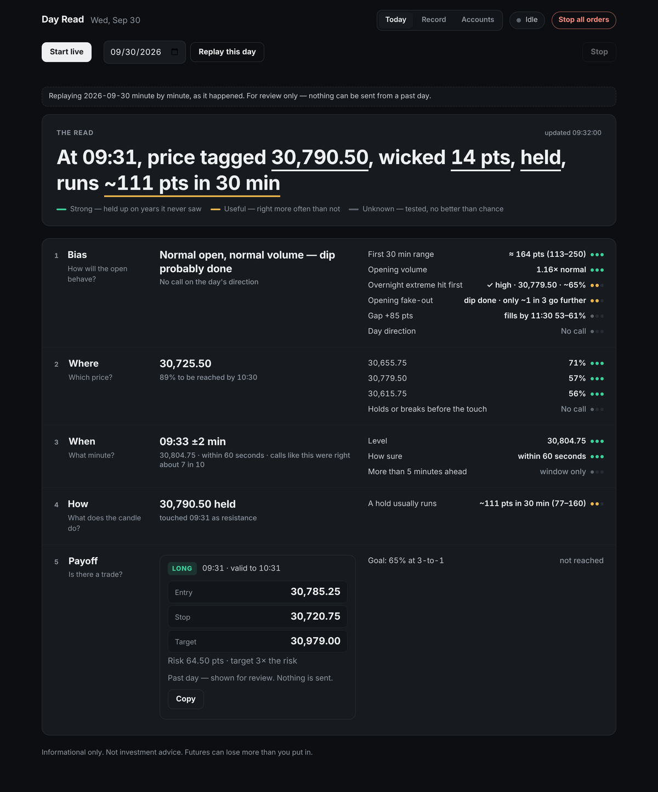
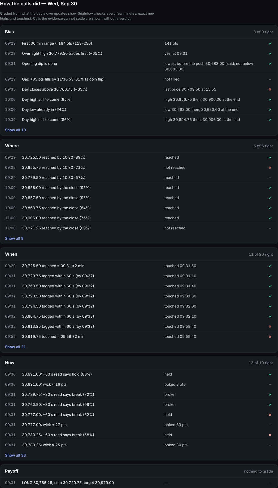
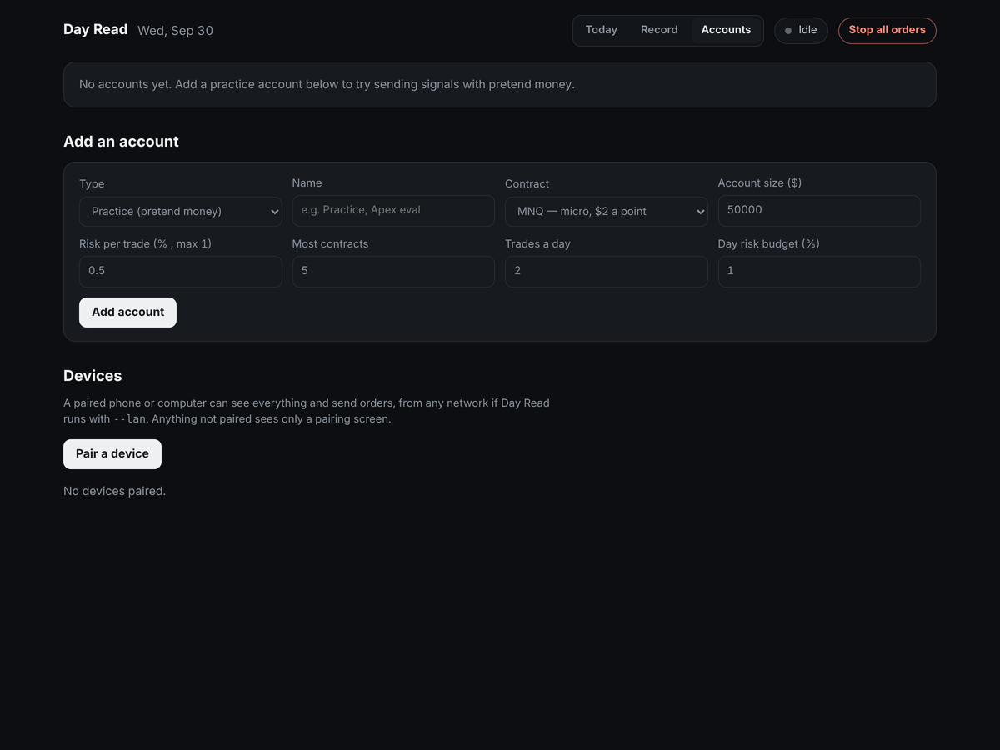
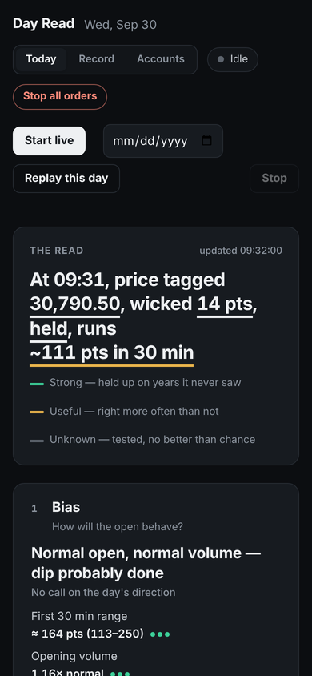

# Day Read

Day Read is a local app that reads the NQ futures session as it happens. It puts the read into one line at the top of the screen, something like "At 09:41 ±2 min, price tags 25,592.00, wicks ≈ 8 pts, holds or breaks?, runs ?", and fills in the rest of that line as price reaches the level and reacts.

What the research behind it found, with the numbers, is in the [write-up](WRITEUP.md).

Every part of the read is marked with how far you can trust it. Green means it held up on years the model never saw. Amber means it's right more often than not. Grey means it was tested and came out no better than a coin flip, and it stays on screen so you don't lean on it.



## What's on the screen

The read is split into five parts, in the order I think about a session:

1. Bias: how big and busy the open will be, which overnight extreme trades first, and whether the opening dip is done.
2. Where: which nearby prices are likely to trade, and by when.
3. When: the minute a level should be touched, once price is close enough for that to mean something.
4. How: what the touch candle does, whether the level held or broke, and how fast the move ran after.
5. Payoff: the trade signal, if one qualifies, with entry, stop and target on real 0.25 ticks.

You can run it live from about 09:15 ET, or replay any past session minute by minute. A replayed day is for review only, and nothing can be sent from it.

## End-of-day report

When a full session finishes, Day Read lists every call it made that day under the same five parts, next to what actually happened, and marks each one right, wrong or not graded. Calls that the day's own data can't settle fairly get no verdict.



## Accounts and orders

Day Read starts with no accounts. You can add a practice account with pretend money, or connect a real platform through a webhook. Each account is set to Off, Confirm (you press Send) or Auto. Order sizes come from your account size, your risk per trade (capped at 1%) and the stop distance. Every order passes the same checks first: a daily trade limit, a daily risk budget, one order per signal per account, and a switch that stops all orders. Webhook addresses and keys stay in a file on your computer that only you can read.



## On your phone

Day Read runs on your own computer. To use it from your phone, start it with `--lan`, open Accounts → Devices on the computer and press Pair a device, then type the one-time code on the phone. A device that isn't paired only sees the pairing screen. With Tailscale on both devices, the phone can reach it from any network.



## What's in this repository

The app is here: the local server, the screen, accounts and order checks, phone pairing, the end-of-day report and the record view. The engine that produces the read is private and isn't included, so the app on its own shows "No engine is installed".

If you want to plug in your own engine, Day Read runs `app/desk/signals.py` and reads one JSON object per line from it:

```json
{"type": "signal", "id": "a1b2c3d4", "ts": "2026-09-30T09:31:40-04:00", "sym": "NQ", "side": "LONG",
 "entry": 30785.25, "stop": 30720.75, "target": 30979.0, "until": "2026-09-30T10:31:40-04:00",
 "risk_pts": 64.5, "replay": true}
{"type": "fact", "at": "2026-09-30T09:30:10-04:00", "f": "touch", "l": 30691.0, "side": "support", "poke": 14}
{"type": "done"}
```

The fact types the screen understands are listed in the `take()` function in `app/desk/ui.html`. The Record tab reads a trade history from `history/trades.parquet` (columns `day`, `side`, `r`), or from the path in `DAYREAD_HISTORY`.

## Running it

You need Python 3.10 or newer. The app uses only the standard library, and pandas with pyarrow if you want the Record tab.

```bash
./app/start_dayread.sh            # macOS / Linux
app\start_dayread.bat             # Windows
python app/dayread_app.py --lan   # let paired devices connect
```

It opens in your browser at `http://127.0.0.1:8765`. To run the tests:

```bash
python -m pytest tests -q
```

## Research

[public/RESEARCH_NOTES.md](public/RESEARCH_NOTES.md) covers what the research behind Day Read found, what didn't work, and the testing habits I'd recommend to anyone trying something similar. It describes results, not the recipe.

[WRITEUP.md](WRITEUP.md) is the full project write-up (also at public/WRITEUP.md): the data, how each idea was tested, the numbers that held up and the ones that didn't, and the mistakes caught along the way.

---

Informational only. Not investment advice. Futures can lose more than you put in.

Copyright © 2026 sh1lll. All rights reserved. See [LICENSE.md](LICENSE.md).
